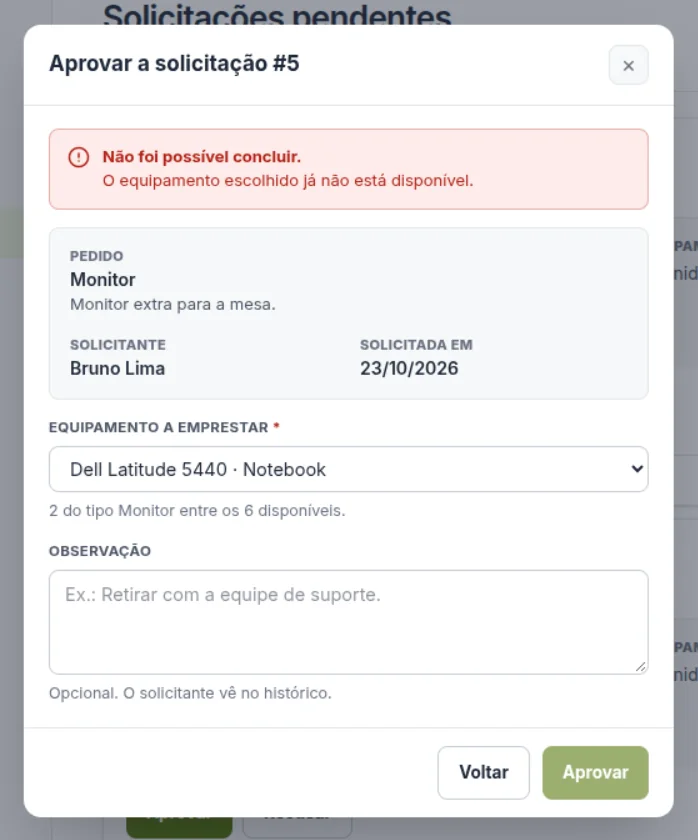
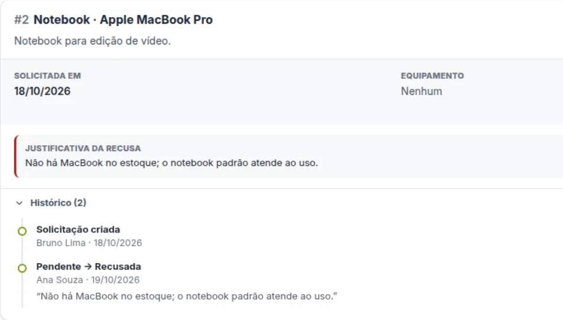

## O problema e o objetivo

Teste técnico full-stack: um sistema em que o solicitante pede equipamentos e acompanha os próprios pedidos, e o aprovador cuida do inventário e decide cada pedido, com justificativa. A regra crítica da especificação é que só o aprovador cadastra equipamentos e toma decisões.

**Está entregue e no ar, com dados fictícios.** Todos os requisitos obrigatórios estão implementados, e o projeto inteiro sobe com um `docker compose up`. O endereço público usa os usuários de teste do README, e os dados podem ser zerados a qualquer momento.

## Como funciona

| Peça | O que é |
|---|---|
| **Navegador** | React 19 com Vite, TypeScript e Tailwind. Cada tela trata carregamento, erro e validação. |
| **Servidor web** | Caddy: entrega o React e repassa `/api` ao backend, no mesmo endereço. |
| **API** | Node.js com Express 5, em camadas: rotas, controllers e services. A entrada é validada com `zod`. |
| **Banco** | MySQL 8.4 com Prisma 6. As migrations e os dados de teste são aplicados sozinhos no primeiro boot. |
| **Infra** | Local, um `docker compose up`. No servidor, a mesma imagem atrás do Caddy da VPS, com deploy a cada push na `main`. |

O caminho de uma aprovação:

1. O aprovador clica em Aprovar, e o diálogo busca na hora os equipamentos disponíveis.
2. O Caddy repassa o pedido à API, e o navegador manda o cookie do login junto.
3. A API confere o token, recusa com 403 quem não é aprovador e valida o id e o corpo.
4. O service abre uma transação: a solicitação só muda se ainda estiver pendente, e o equipamento só se ainda estiver disponível. O histórico ganha uma linha.
5. Se alguma condição falhar, a resposta é 409 e nada fica gravado. A tela mostra a mensagem e recarrega a lista.

## Três decisões e o que elas custaram

<Decisao
  titulo="A proteção contra decisão em dobro fica na condição do UPDATE"
  contexto="Dois aprovadores podem abrir a mesma solicitação ao mesmo tempo, ou escolher o mesmo equipamento para pedidos diferentes."
  escolhi="Uma transação em que a solicitação só muda se ainda estiver PENDENTE, e o equipamento só se ainda estiver DISPONIVEL. Zero linhas alteradas viram 409 e desfazem o resto."
  descartei="Ler o status e depois atualizar. Entre a leitura e a escrita, outro pedido pode mudar o estado."
  custo="Quem perde a disputa recebe 409 e precisa escolher de novo."
/>

<Decisao
  titulo="Token em cookie httpOnly, com a API no mesmo endereço"
  contexto="O login com JWT era um diferencial opcional. Sem ele, o perfil viria do corpo da requisição, e a regra crítica não se sustentaria."
  escolhi="JWT em cookie httpOnly e SameSite=Strict. Como o Caddy serve o React e a API no mesmo endereço, o navegador manda o cookie sozinho, sem CORS."
  descartei="Guardar o token no localStorage, que um script injetado na página consegue ler. E guardar só em memória, que desloga a cada F5."
  custo="Duas rotas a mais, para saber quem está logado e para sair. E o token vale até expirar: não dá para revogá-lo."
/>

<Decisao
  titulo="O solicitante não vê o estoque"
  contexto="A especificação diz que o solicitante faz pedidos e acompanha os próprios, sem falar em consultar equipamentos."
  escolhi="Ele descreve o que precisa, e o aprovador escolhe a unidade ao aprovar. As rotas de equipamentos são só do aprovador. É o fluxo que vi no suporte: quem pede descreve a necessidade, e quem cuida dos ativos decide o que entregar."
  descartei="Mostrar o estoque a todos, o que faria dois solicitantes disputarem a mesma unidade."
  custo="O solicitante não sabe se há equipamento antes de pedir, e um pedido sem estoque termina em recusa, com justificativa."
/>

## O trecho que vale ler

É a aprovação. As duas condições no `where` são o que impede a decisão em dobro, e o `throw` dentro da transação desfaz o que já tinha sido alterado.

<Terminal arquivo="backend/src/services/solicitacaoService.js">

```js
async function aprovar(id, dados, aprovadorId) {
    const { equipamentoId, observacao } = dados

    return prisma.$transaction(async (tx) => {
        const solicitacao = await tx.solicitacao.findUnique({ where: { id } })
        if (!solicitacao) {
            throw new ErroApp(404, 'Solicitação não encontrada.')
        }

        const equipamento = await tx.equipamento.findUnique({ where: { id: equipamentoId } })
        if (!equipamento) {
            throw new ErroApp(422, 'Equipamento não encontrado.')
        }

        // Ordem fixa dos bloqueios (solicitação, depois equipamento), para evitar deadlock.
        const solicitacaoAlterada = await tx.solicitacao.updateMany({
            where: { id, status: 'PENDENTE' },
            data: { status: 'APROVADA', equipamentoId, aprovadorId, observacao, dtDecisao: new Date() },
        })
        if (solicitacaoAlterada.count === 0) {
            throw new ErroApp(409, 'A solicitação já não está pendente.')
        }

        // O erro desfaz a alteração da solicitação, que volta a PENDENTE.
        const equipamentoAlterado = await tx.equipamento.updateMany({
            where: { id: equipamentoId, status: 'DISPONIVEL' },
            data: { status: 'EMPRESTADO' },
        })
        if (equipamentoAlterado.count === 0) {
            throw new ErroApp(409, 'O equipamento escolhido já não está disponível.')
        }

        await tx.historicoSolicitacao.create({
            data: { solicitacaoId: id, usuarioId: aprovadorId, statusAnterior: 'PENDENTE', statusNovo: 'APROVADA', observacao },
        })

        return tx.solicitacao.findUnique({ where: { id }, include: INCLUIR })
    })
}
```

</Terminal>

## Como foi comprovado as regras

Não há testes automáticos: as regras foram provadas com `curl`, primeiro contra a API sem banco, para as barreiras de login, perfil e validação, e depois com o `docker compose up` e os dados de teste. Estas são respostas reais:

<Terminal arquivo="curl contra a API, com os dados de teste (21/10/2026)">

```text
# solicitante tentando ver a fila do aprovador
403 Seu perfil não tem permissão para esta ação.
# Bruno cancelando a solicitação #4, que é da Cristina
404 Solicitação não encontrada.
# aprovar a #4 com um equipamento que não existe
422 Equipamento não encontrado.
# aprovar a #4 com o ThinkPad, que já está emprestado
409 O equipamento escolhido já não está disponível.
# aprovar a #4 com o Latitude, disponível
200 #4 APROVADA | Cristina Rocha | equip: Latitude 5440
# aprovar a #4 de novo
409 A solicitação já não está pendente.
```

</Terminal>

Depois do primeiro 409, a #4 continuou pendente, sem equipamento e sem linha nova no histórico: é a transação desfazendo a alteração. E a solicitação de outra pessoa responde 404, e não 403, para não confirmar que ela existe.

Na tela, testei a mesma disputa com duas janelas abertas como aprovador. Numa, a #4 foi aprovada com o Dell Latitude 5440. Na outra, a aprovação da #5 com o mesmo equipamento recebeu o 409:



E o solicitante vê a justificativa que o aprovador escreveu, no cartão e no histórico:



## O que quebrou

| Sintoma | Causa e correção |
|---|---|
| **Erro de digitação que passava em todos os testes (17/10)** | `proccess` numa linha que só roda quando falta uma variável de ambiente. Só apareceu testando o caminho de erro, que passou a ser testado sempre. |
| **Equipamento emprestado antes de existir (20/10)** | Os dados de teste cadastravam usuários e equipamentos na hora do boot, depois de solicitações de dias atrás. As datas de cadastro passaram para 30 dias antes. |
| **Atribuição ao `req.query` sumindo sem erro (20/10)** | No Express 5, o `req.query` é recalculado a cada leitura. Achado num teste antes do código: a validação passou a guardar o resultado em `req.validado`. |
| **403 em rota que não era do perfil (20/10)** | Um `router.use` com a exigência de perfil valia para toda a `/api`, até para rota inexistente. Também achado antes do código: o perfil passou a ser exigido em cada rota. |

## Conceitos que aprendi

| Conceito | O que é | Onde está |
|---|---|---|
| **UPDATE condicional** | Alteração que só acontece se a linha ainda estiver no estado esperado. | `solicitacaoService.js` |
| **Cookie httpOnly e SameSite** | Cookie que o JavaScript da página não lê e que outro site não consegue fazer o navegador enviar. | `autenticacaoController.js` |
| **Ataque de tempo** | Descobrir quais e-mails existem pelo tempo da resposta. O login compara a senha com um hash falso quando o e-mail não existe. | `autenticacaoService.js` |
| **Índice composto** | Só ajuda a consulta que filtra pela primeira coluna dele. Por isso o filtro só por tipo ganhou um índice próprio. | `schema.prisma` |

## Em andamento

- CI na `staging`, com build e checagem a cada push
- Limite de tentativas no login, registrado como dívida técnica
- Modo escuro e menu recolhível, como no protótipo
- O plano completo está no [roadmap do projeto](https://github.com/JoaoMendes1/helpdesk-corporativo/blob/main/docs/ROADMAP.md)